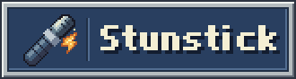
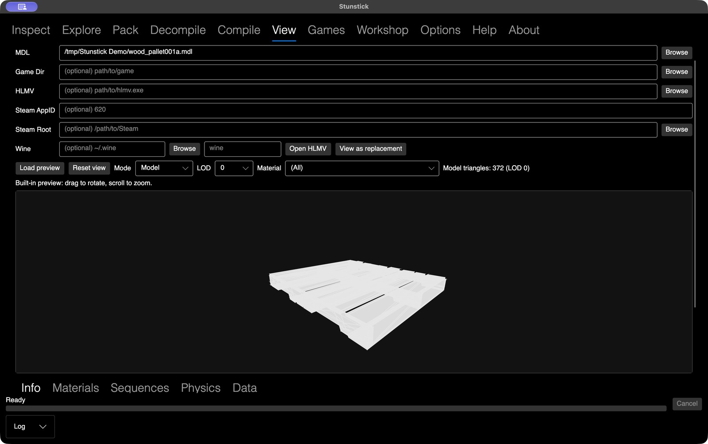

# 

Stunstick is a cross-platform fork of Crowbar for working with GoldSource and Source game assets. It provides an Avalonia desktop app and a scriptable CLI for Windows, macOS, and Linux.

**Experimental.** Releases are prereleases. Model and toolchain support varies by game and format.



*Stunstick’s View tab showing Valve’s Source wood pallet model and its LOD 0 triangle count.*

## What you can do

| Workflow | Desktop tabs |
| --- | --- |
| Inspect models and browse or extract VPK, FPX, and GMA archives | **Inspect**, **Explore** |
| Decompile supported models to QC, SMD, VTA, and other source files | **Decompile** |
| Compile QC files with StudioMDL and preview the result | **Compile**, **View** |
| Pack archives or manage supported Steam Workshop items | **Pack**, **Workshop** |

## Get started

1. Download the ZIP for your platform from [GitHub Releases](https://github.com/programmer1o1/Stunstick/releases) and install the .NET 8 runtime.
2. Extract the entire ZIP. Run **Stunstick** from the `desktop` folder or use `stunstick` from the `cli` folder.
3. To rebuild a model, open it in **Decompile** and choose an output folder. Select **Use output QC in Compile** after decompilation. Set your game directory and StudioMDL in **Games** or **Compile**, then compile the QC.

Keep any companion files next to the input MDL. A Source model may use `.vvd`, `.vtx`, `.phy`, or `.ani` companions.

## Build from source

With the .NET 8 SDK installed, run these commands from the repository root.

```sh
dotnet build Stunstick.CrossPlatform.sln
dotnet test Stunstick.CrossPlatform.sln
dotnet run --project src/Stunstick.Desktop
dotnet run --project src/Stunstick.Cli -- --help
```

## Documentation

- [Platform setup and CLI examples](CROSS_PLATFORM.md)
- [FAQ and bug reports](FAQ.md)
- [Crowbar parity and verification coverage](parity.md)
- [Build the bundled StudioMDL](tools/studiomdl/README.md)

Stunstick builds on [Crowbar](https://steamcommunity.com/groups/CrowbarTool). The repository also contains the original Windows application in `Crowbar.sln`. See the [license](LICENSE.txt).
